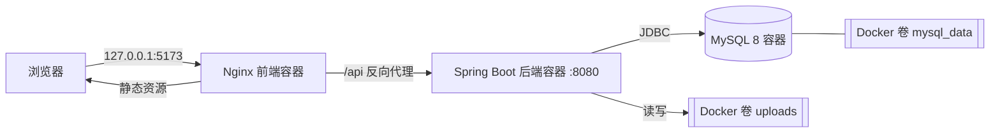

# 🍃 薄荷日记 · Mint Diary

> 一个跑在自己电脑上的私密图文日记与纪念日网站。日记、图片和纪念日全部保存在本机 Docker 数据卷中，不依赖云服务，也不上传到任何第三方。

[](LICENSE)
[](https://vuejs.org/)
[](https://spring.io/projects/spring-boot)
[](https://openjdk.org/)
[](compose.yaml)

## 简介

薄荷日记是一个自托管的单用户日记应用：以日历为主视图，每天一篇日记，可以写文字、插入图片；另有独立的纪念日页面，记录最初发生的日期并自动计算累计天数。界面使用薄荷绿与暖白配色，桌面端优先。

三个容器分别承担前端、后端和数据库，只有网页端口绑定到 `127.0.0.1`，后端和 MySQL 不对外暴露。

## 功能特性

- **日历日记**：点击任意日期撰写日记，同一天始终编辑同一篇；月历上标记有内容的日子。
- **图文混排**：支持 JPG、PNG、GIF、WebP，单张最大 10 MB，一篇最多 20 张；可预览、排序和移除。
- **草稿保护**：切换日期、页面或关闭标签页时，若有未保存的修改会提示确认。
- **纪念日**：记录原始日期、备注和可选封面，显示原始日期与累计天数。
- **年度标记**：纪念日每年在同一个公历月日出现在日历中，2 月 29 日只在闰年显示。
- **可靠的日期规则**：开始当天为第 0 天，次日为第 1 天；未来日期显示“还有 X 天”；跨天自动刷新。
- **数据自持**：MySQL 与图片存放在 Docker 卷中，重建容器不丢数据；数据库密码由脚本随机生成。
- **容器内自检**：前端构建时运行日期单元测试、TypeScript 检查和生产构建，后端构建时运行 H2 集成测试，任何一步失败都不会产出镜像。

## 技术栈

| 层 | 技术 |
| --- | --- |
| 前端 | Vue 3、TypeScript、Vite、Vue Router、lucide 图标 |
| 后端 | Spring Boot 3.5、Spring MVC、Spring JDBC、Bean Validation、Java 17 |
| 数据库 | MySQL 8（运行时）、H2（测试） |
| 部署 | Docker Compose、Nginx、多阶段构建 |
| 测试 | Vitest、Spring Boot Test |

## 架构



前端通过同源 `/api` 请求后端；日记日期是数据库主键。图片原文件保存在 `uploads` 卷，数据库只保存元信息与关联关系。跨年纪念日和累计天数始终基于原始日期计算，不会每年重置。

## 快速开始

### 前置要求

- [Docker Desktop](https://www.docker.com/products/docker-desktop/)（使用 Linux 容器）
- Windows 用户可直接使用仓库内的 PowerShell 脚本；macOS / Linux 使用下方的手动命令

### 获取代码

```bash
git clone https://github.com/yrykbz-art/mint-diary.git
cd mint-diary
```

### Windows：一键启动

先启动 Docker Desktop，然后在项目目录打开 PowerShell：

```powershell
.\start.ps1
```

脚本会自动生成含随机密码的 `.env`、校验 Compose 配置、构建并启动容器，并等待服务就绪。首次构建需要联网拉取镜像和依赖。

打开 <http://localhost:5173> 即可使用。

停止服务（保留全部数据）：

```powershell
.\stop.ps1
```

已经构建过镜像时，可以用 `.\start.ps1 -NoBuild` 跳过重新构建。

如果当前终端禁止运行本地脚本，可临时绕过，不会修改系统执行策略：

```powershell
powershell -NoProfile -ExecutionPolicy Bypass -File .\start.ps1
```

### macOS / Linux：手动启动

```bash
cp .env.example .env
# 编辑 .env，把两个密码替换为随机值，例如：
# openssl rand -hex 24
docker compose up -d --build
```

打开 <http://localhost:5173>。停止：

```bash
docker compose stop
```

### 查看状态

```bash
docker compose ps
docker compose logs --tail=100 backend
```

## 配置

配置通过项目根目录的 `.env` 读取（模板见 [`.env.example`](.env.example)）。

| 变量 | 默认值 | 说明 |
| --- | --- | --- |
| `APP_PORT` | `5173` | 网页映射到本机的端口，仅绑定 `127.0.0.1` |
| `MYSQL_DATABASE` | `mint_diary` | 数据库名 |
| `MYSQL_USER` | `mint_diary` | 应用数据库用户 |
| `MYSQL_PASSWORD` | 无（必填） | 应用数据库密码，由 `start.ps1` 随机生成 |
| `MYSQL_ROOT_PASSWORD` | 无（必填） | MySQL root 密码，由 `start.ps1` 随机生成 |
| `APP_TIME_ZONE` | `Asia/Singapore` | 业务日期与数据库时区 |

修改 `APP_PORT` 后重新启动即可。**保留已有数据卷时也必须保留原来的 `.env`**，否则新密码无法连接旧数据库。

## 使用说明

- **日历日记**：点击日期，输入文字或添加图片，点击“保存日记”。同一天始终编辑同一篇。
- **图片**：点击缩略图预览，右上角按钮可移除；增删图片后需要保存才会生效。
- **未保存的修改**：切换日期、切换页面或关闭网页时会提示；图片上传完成不等于日记已保存。
- **纪念日**：填写最初发生的完整日期，可以添加备注及可选封面。单独页面显示原始日期和累计天数。
- **天数规则**：开始当天为 0 天，第二天为 1 天；未来日期显示“还有 X 天”。页面重新激活及跨天时会刷新。
- **删除**：删除日记会同时删除图片关联，未被其他记录使用的图片文件会清理；删除纪念日不会影响当天日记。

网站首次启动是一个空白的个人记录空间，不会自动写入演示数据。

## 数据与备份

Compose 项目名固定为 `mint-diary`。

| 内容 | 位置 |
| --- | --- |
| MySQL 数据 | Docker 卷 `mint-diary_mysql_data` |
| 上传图片 | Docker 卷 `mint-diary_uploads` |
| 本地配置 | 项目根目录 `.env`（已被 Git 忽略） |

重新构建镜像、重启或普通停止都不会删除数据卷。备份时需要同时保存**两个数据卷**和 `.env`。停止服务后可这样打包数据卷：

```bash
docker compose stop
docker run --rm -v mint-diary_mysql_data:/data -v "$PWD":/backup alpine tar czf /backup/mysql-data.tar.gz -C /data .
docker run --rm -v mint-diary_uploads:/data -v "$PWD":/backup alpine tar czf /backup/uploads.tar.gz -C /data .
```

恢复时把归档解压回同名卷即可。请注意：`docker compose down -v` 会删除数据卷，日常停止请使用 `stop.ps1` 或 `docker compose stop`。

## 项目结构

```text
mint-diary/
├── backend/                    Spring Boot 3.5 + JDBC（Java 17）
│   ├── src/main/java/local/mintdiary/
│   ├── src/main/resources/     application.yml、schema.sql
│   └── src/test/               H2 集成测试与日期规则测试
├── frontend/                   Vue 3 + TypeScript + Vite
│   ├── src/views/              日历日记、纪念日两个主页面
│   ├── src/components/         对话框、图标等基础组件
│   └── src/dates.ts            前端日期工具
├── compose.yaml                Nginx 前端、Java 后端、MySQL 8 编排
├── start.ps1                   生成本地配置、构建并启动、等待就绪
├── stop.ps1                    停止容器并保留数据
├── .env.example                配置模板
└── README.md
```

## 本地开发

### 前端

```bash
cd frontend
npm ci
npm run dev      # http://127.0.0.1:5173，/api 代理到 127.0.0.1:8080
npm test         # Vitest 日期测试
npm run build    # TypeScript 检查 + 生产构建
```

### 后端

后端默认连接 `127.0.0.1:3306/mint_diary`，可通过环境变量覆盖：

| 变量 | 默认值 |
| --- | --- |
| `DB_URL` | `jdbc:mysql://127.0.0.1:3306/mint_diary?...` |
| `DB_USERNAME` | `mint_diary` |
| `DB_PASSWORD` | 空 |
| `APP_UPLOAD_DIR` | `./.local/images` |
| `APP_TIME_ZONE` | `Asia/Singapore` |
| `APP_ALLOWED_ORIGINS` | `http://localhost:5173,http://127.0.0.1:5173` |

```bash
cd backend
mvn spring-boot:run   # 需要可用的 MySQL
mvn test              # 测试使用 H2 内存库，无需 MySQL
```

无需单独安装或修改宿主机的 Java、MySQL、Nginx，也不需要 Redis、云存储或外部账号（使用 Docker 方式时）。

## API 概览

后端提供同源 `/api` 接口，日期格式为 `yyyy-MM-dd`，月份为 `yyyy-MM`。

| 方法 | 路径 | 说明 |
| --- | --- | --- |
| `GET` | `/api/health` | 健康检查，返回服务日期与时区 |
| `GET` | `/api/calendar?month=yyyy-MM` | 某月的日记与纪念日标记 |
| `GET` | `/api/diaries/{date}` | 读取某天日记 |
| `PUT` | `/api/diaries/{date}` | 保存某天日记（文字与图片 ID 列表） |
| `DELETE` | `/api/diaries/{date}` | 删除某天日记 |
| `GET` | `/api/anniversaries` | 纪念日列表 |
| `POST` | `/api/anniversaries` | 新建纪念日 |
| `PUT` | `/api/anniversaries/{id}` | 修改纪念日 |
| `DELETE` | `/api/anniversaries/{id}` | 删除纪念日 |
| `POST` | `/api/images` | 上传图片（multipart 字段名 `file`） |
| `DELETE` | `/api/images/{id}` | 删除未被引用的图片 |
| `GET` | `/api/images/{id}/content` | 读取图片原文件 |

## 安全说明

这是一个**单用户、仅本机使用**的应用，没有登录和权限系统，请勿将端口暴露到公网或局域网。

- 网页端口默认只监听 `127.0.0.1`；后端与数据库不发布到宿主机端口。
- 写操作会校验 `Origin`，拒绝来自非白名单页面的跨站修改请求。
- 上传图片按文件头识别真实格式，限制 10 MB 与 4000 万像素，并在入库前解码验证。
- `.env`（含数据库密码）已被 `.gitignore` 排除，`start.ps1` 会生成 24 字节随机密码。

## 许可证

本项目采用 [MIT License](LICENSE) 开源。
